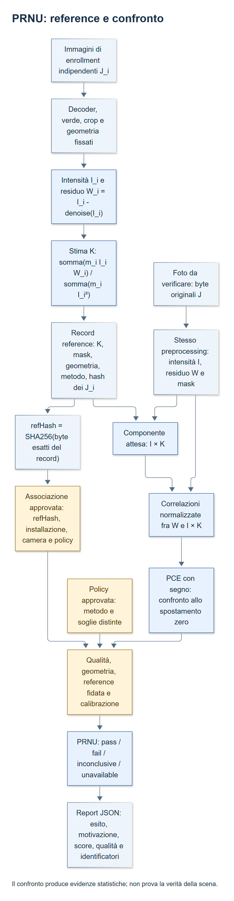
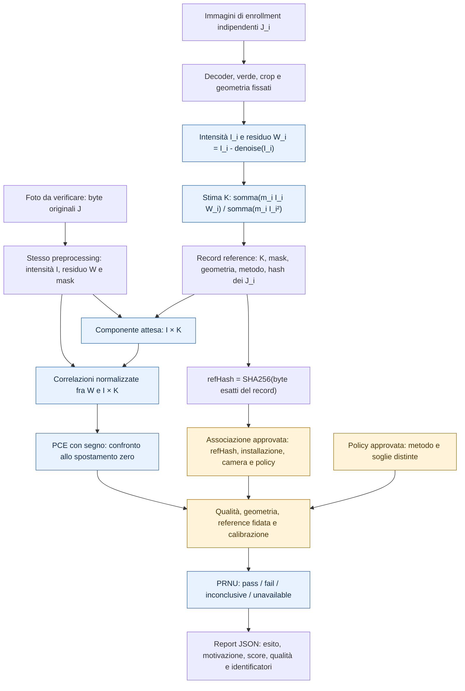
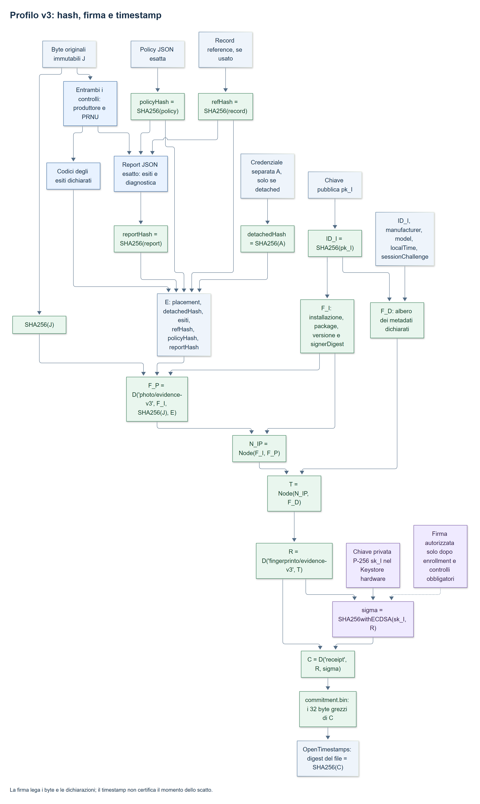
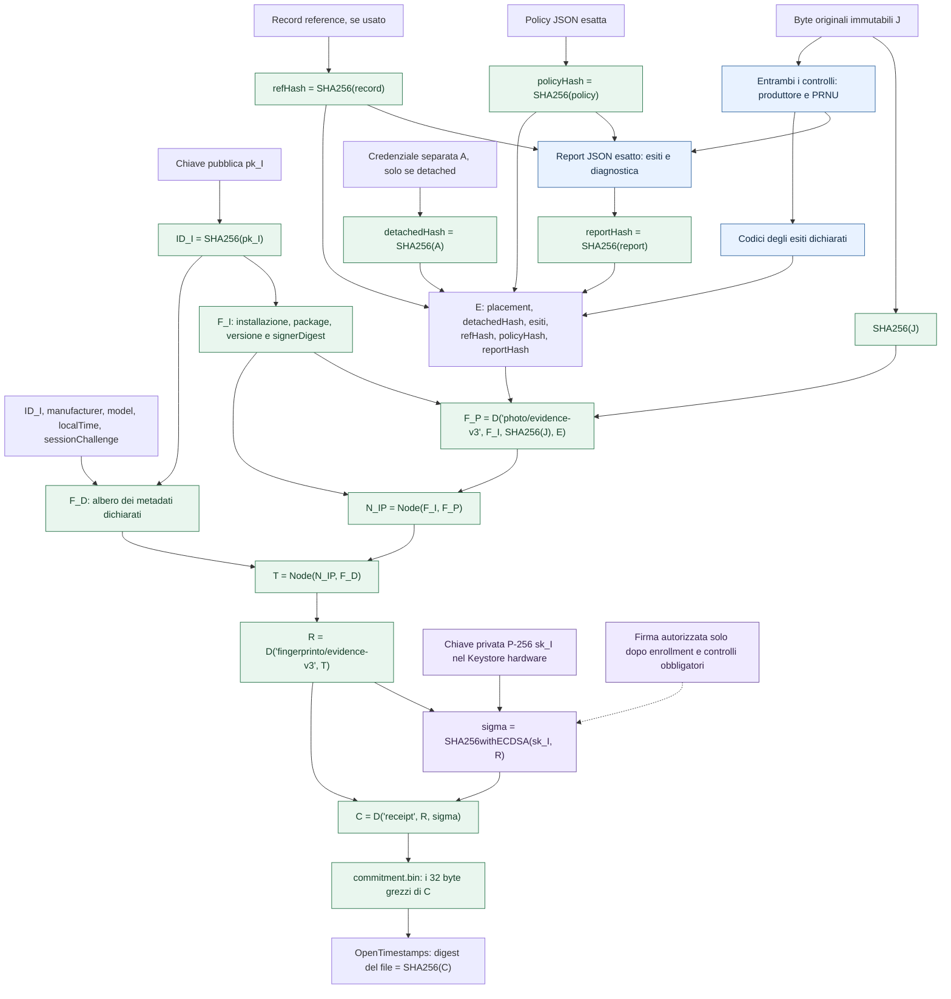

# PRNU, hash e firma: schema del profilo v3

Questo schema descrive il profilo **P-256 v3**, separato dall'esperimento ibrido
v2. Il PRNU produce un risultato statistico; hash e firma legano ai byte esatti
quel risultato e le evidenze usate. Non trasformano il risultato in una prova
della verità della scena. Le parti ancora mancanti sono nell'[audit](CRYPTO-MODULE-AUDIT.md).

## 1. Dal sensore al confronto PRNU



<details>
<summary>Sorgente Mermaid del diagramma PRNU</summary>



</details>

`K` è stimato da immagini diverse da `J`: la query non entra nella propria
reference. Dopo residui e stima vengono applicate le soppressioni di artefatti
di riga/colonna previste dal metodo.

Nel metodo sperimentale corrente la griglia è `[-3,3] × [-3,3]`, con allineamento
atteso a zero. Non si sceglie il massimo della superficie:

```text
r0  = correlazione allo spostamento (0,0)
PCE = sign(r0) × r0² / media(r_shift² fuori dalla finestra centrale 3×3)
```

Energia nulla o area valida insufficiente danno un risultato inconcludente.
Le soglie di accettazione e rifiuto si abilitano separatamente: senza relativa
calibrazione approvata non si emette il corrispondente pass/fail. Vedi il
[metodo PRNU](PRNU-EXPERIMENT.md) per maschere, denoiser e parametri esatti.

## 2. Dagli esiti al commitment firmato



<details>
<summary>Sorgente Mermaid del diagramma hash e firma</summary>



</details>

Qui `D` non è una concatenazione ambigua di stringhe:

```text
D(label, x1, ...) = SHA256(CBOR_deterministico([label, x1, ...]))
Node(a, b)        = D("node", a, b)
F_I               = D("install", ID_I, packageName, versionCode, signerDigest)
E                 = [placement, detachedHash, manufacturerResult, prnuResult,
                     refHash, policyHash, reportHash]
```

Gli esiti sono interi: `0` unavailable, `1` inconclusive, `2` pass, `3` fail.
`placement` è `0` embedded, `1` detached, `2` absent. Se non è detached,
`detachedHash` è null; senza reference `refHash` è null. Policy e report sono
allegati obbligatori, conservati e hashati nei loro byte originali.

`F_D` usa cinque foglie, nell'ordine indicato nel disegno. Ogni foglia è
`L_i = D("field", nome, valore)` e l'albero è
`Node(Node(Node(L0,L1), Node(L2,L3)), L4)`. I metadati firmati sono dichiarazioni:
in particolare `localTime` non diventa un orario di scatto certificato.

`SHA256withECDSA` applica SHA-256 ai 32 byte di `R` internamente, come nel codice.
La ricevuta conserva la firma DER esatta; cambiarla cambia anche `C`. I tentativi
successivi riutilizzano la ricevuta persistita. Per OTS si usa il file binario
di `C`, non l'hex di `C`, la foto o il file della ricevuta.

## 3. Cosa verifica chi riceve il fascicolo

Il verificatore ricalcola gli hash degli allegati e di `J`, ricostruisce `R` e
`C`, verifica la firma e l'enrollment, poi rivaluta i due controlli con la propria
policy fidata. Un `pass` scritto nel report firmato non basta. La prova OTS viene
verificata separatamente rispetto a `SHA256(C)`.

Se `J` viene alterato **dopo** la firma, il collegamento hash/firma non verifica.
Se un PRNU contraffatto inganna il controllo **prima** della firma, si può invece
firmare una conclusione statistica sbagliata: hash, Keystore e timestamp non
rilevano automaticamente quella falsificazione. Né il PRNU né il timestamp
dimostrano la verità della scena.

Riferimenti al codice: [PRNU](../fingerprinto/prnu.py),
[costruzione v3](../fingerprinto/receipt_v3.py),
[orchestrazione e verifica](../fingerprinto/workflow_v3.py),
[ancoraggio OTS](../fingerprinto/anchoring_v3.py).

## Rigenerare i PNG

Le immagini sono renderizzate dai due blocchi Mermaid di questo documento, a
scala 2 su sfondo bianco. Dopo una modifica ai diagrammi, rigenerare anche i PNG.
Lo script è [render_crypto_diagrams.py](../scripts/render_crypto_diagrams.py).

Il rendering usa il bundle standalone `dist/mermaid.min.js` del pacchetto
`mermaid@12.3.0`, `playwright==1.65.2` e un Chrome/Chromium/Edge già installato:

```sh
python -m pip install playwright==1.65.2
python scripts/render_crypto_diagrams.py --mermaid-bundle /percorso/mermaid/dist/mermaid.min.js
```

Se necessario, specificare il browser con `--browser /percorso/eseguibile`.
Il bundle è disponibile nella [distribuzione ufficiale Mermaid su npm](https://www.npmjs.com/package/mermaid/v/12.3.0).
Il renderer blocca le richieste di rete del browser e non scarica un browser,
non esegue test del modulo e non richiede Android SDK.
