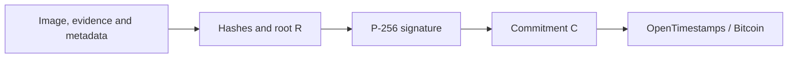

<!-- AGENT CONSTRAINT: This file contains content and visual guidance for ONLY THREE crypto slides, coordinated with the complete pitch in docs/pitch/pitch.md. The full presentation must fit 180 seconds TOTAL, including the approximately 30-second demo, pauses and handoffs. These crypto slides occupy 0:40-1:50 (70 seconds); their separate absolute ceiling remains 90 seconds, but extending them requires cutting another block. They become presentation slides 2-4, between the proposed introductory and closing slides described in pitch.md. All spoken text, including demo narration, is in pitch.md; do not add oral explanations. Formulas are optional visual support and MUST NOT be spoken. Keep elements few and readable; distinguish implemented features, proposals and outstanding validation. Comments are editorial instructions, not projected text. -->

# The problem happens before signing

**No cryptographic proof of physical origin without a trusted capture path.**

**One format. Assurance matched to the evidence.**

| Manufacturer capture attestation | PRNU compatibility | File integrity |
|---|---|---|
| Where available and verified | Statistical sensor evidence | Cryptographic hashes and signatures |

**Physical capture does not establish scene truth.**

<!-- SLIDE 1 - Approximately 35 seconds; first two spoken paragraphs of the crypto block in pitch.md. Visual: three adjacent evidence cards. Evidence can coexist; manufacturer verification does not exclude PRNU checking. Assess assurance per capture, not merely per device. A hostile client can inject frames before signing; key or app attestation alone does not attest the frame. The prototype still lacks a real manufacturer validator. Do not imply verified support on particular vendors or devices. PRNU is statistical compatibility, not cryptographic proof, and can be spoofed. -->

---

# A verifiable receipt

$$
C = D(\texttt{receipt}, R, \sigma)
\qquad
h_{\mathrm{OTS}} = \mathrm{SHA256}(C)
$$

**Anchoring records commitments, not scene truth or capture time.**

<!-- SLIDE 2 - Approximately 15 seconds; third spoken paragraph of the crypto block in pitch.md. This is a flow summary, not the complete dependency graph: C binds both R and the signature. The installation key is protected by hardware Keystore; this does not make it a sensor signature. D means SHA256 over a deterministic CBOR array with domain separation; OTS receives the 32 raw bytes of C and hashes them. Anchoring is verifiable once the OTS proof is completed and checked. The formula is optional: DO NOT read it. See ../diagrams/crypto-flow.md and its PNGs for technical detail; do not paste the entire vertical diagram onto this slide. -->

---

# Verification need not disappear with a vendor

**Proposed contribution:** interoperable evidence and lasting verification.

- Preserve certificates, manifests, policies and authenticated status evidence.
- Preserve the material needed to assess trust at the relevant time.

**Implemented:** offline crypto core.

**Unfinished:** real capture integrations, calibration and validation.

<!-- SLIDE 3 - Approximately 20 seconds; final two spoken paragraphs of the crypto block in pitch.md. Historical verification is a proposed contribution, not an already implemented long-term archive or an unconditional guarantee. Anchoring a certificate establishes the existence of those bytes, not issuer trust or absence of key compromise. Historical verification also requires trust policies, authenticated status evidence and continued cryptographic validity. Missing integrations include the manufacturer validator and Android capture path; the latest module fixes await tests on the dedicated branch. No certification, universal-security or completed real-sensor validation claims. Target 70 seconds for the crypto block; absolute crypto maximum 90 seconds, within the 180-second full pitch. -->
