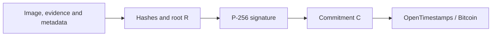

<!-- AGENT CONSTRAINT: This file defines the complete pitch deck: five content slides plus one live-demo screen, six PDF pages TOTAL. The three original crypto slides are retained as presentation slides 2-4. The full pitch must finish within 180 seconds INCLUDING 30 seconds for the demo; target 175 seconds plus 5 seconds buffer. The crypto block is scheduled for 70 seconds and must never exceed 90 seconds / 140 spoken words. Spoken text is ONLY in pitch.md; formulas are visual support and MUST NOT be read aloud. The final what's next slide replaces the existing status/closing slot. Do not add content or extra time. Use the user's Lagrange theme. Distinguish implemented features, proposals and validation gaps; no invented camera-API support or physical-origin guarantees. -->

<!-- BEACON UPDATE: The standalone optical-token experiment is implemented on leomaster, but is not a third origin level or validated physical demonstration. Keep the three crypto slides and the 180-second total unchanged. Any future beacon illustration must label splicing/relay limits and token validity separately from physical presence; no extra spoken material is authorised by this note. -->

Rendered deck: [PDF](fingerprinto-pitch.pdf), [LaTeX source](presentation/main.tex), [Overleaf archive](fingerprinto-pitch-overleaf.zip).

# FingerprinTO

**Evidence you can verify.**

Original + portable receipt + independent verifier.

Integrity. Origin evidence. A record that lasts.

<!-- PRESENTATION SLIDE 1: 0:00-0:40. Combine problem and intended workflow; no extra title-slide speaking slot. The existing FingerprinTO Stand image can occupy the right-hand side. This visual does not imply a sensor-proof implementation. -->

---

# The problem happens before signing

**No cryptographic proof of physical origin without a trusted capture path.**

**One format. Assurance matched to the evidence.**

| Manufacturer capture attestation | PRNU compatibility | File integrity |
|---|---|---|
| Where available and verified | Statistical sensor evidence | Cryptographic hashes and signatures |

Visual PRNU reference estimate (not spoken):

$$
K[p]=\frac{\sum_i m_i[p]I_i[p]W_i[p]}{\sum_i m_i[p]I_i[p]^2},
\qquad W_i=I_i-\mathrm{denoise}(I_i).
$$

**Physical capture does not establish scene truth.**

<!-- SLIDE 1 - Approximately 35 seconds; first two spoken paragraphs of the crypto block in pitch.md. Visual: three adjacent evidence cards. Evidence can coexist; manufacturer verification does not exclude PRNU checking. Assess assurance per capture, not merely per device. A hostile client can inject frames before signing; key or app attestation alone does not attest the frame. The prototype still lacks a real manufacturer validator. Do not imply verified support on particular vendors or devices. PRNU is statistical compatibility, not cryptographic proof, and can be spoofed. -->

---

# A verifiable receipt

$$
\begin{aligned}
F_P &= D(\texttt{photo/evidence-v3},F_I,\mathrm{SHA256}(J),E)\\
R &= D(\texttt{fingerprinto/evidence-v3},\mathrm{Node}(\mathrm{Node}(F_I,F_P),F_D))\\
\sigma &= \mathrm{ECDSA\text{-}P256\text{-}SHA256}(sk_I,R),\qquad
C = D(\texttt{receipt},R,\sigma)\\
h_{\mathrm{OTS}} &= \mathrm{SHA256}(C)
\end{aligned}
$$

**Anchoring records commitments, not scene truth or capture time.**

<!-- SLIDE 2 - Approximately 15 seconds; third spoken paragraph of the crypto block in pitch.md. This is a flow summary, not the complete dependency graph: C binds both R and the signature. The installation key is protected by hardware Keystore; this does not make it a sensor signature. D means SHA256 over a deterministic CBOR array with domain separation; OTS receives the 32 raw bytes of C and hashes them. Anchoring is verifiable once the OTS proof is completed and checked. The formula is optional: DO NOT read it. See ../diagrams/crypto-flow.md and its PNGs for technical detail; do not paste the entire vertical diagram onto this slide. -->

---

# Verification need not disappear with a vendor

**Proposed contribution:** interoperable evidence and lasting verification.

- Preserve certificates, manifests, policies and authenticated status evidence.
- Preserve the material needed to assess trust at the relevant time.

**Implemented:** offline crypto core.

**Unfinished:** real capture integrations, calibration and validation.

<!-- SLIDE 3 - Approximately 20 seconds; final two spoken paragraphs of the crypto block in pitch.md. Historical verification is a proposed contribution, not an already implemented long-term archive or an unconditional guarantee. Anchoring a certificate establishes the existence of those bytes, not issuer trust or absence of key compromise. Historical verification also requires trust policies, authenticated status evidence and continued cryptographic validity. Missing integrations include the manufacturer validator and Android capture path; the latest module fixes await tests on the dedicated branch. No certification, universal-security or completed real-sensor validation claims. Target 70 seconds for the crypto block; absolute crypto maximum 90 seconds, within the 180-second full pitch. -->

---

# Demo recording

**29.4 seconds / 1.5x - supplied PhoTO app walkthrough.**

[Clickable preview](assets/demo-poster.png) / [play video](assets/demo-pitch.mp4).

Capture preparation. Private calibration controls. Device enrollment status.

Missing authority trust stays unavailable. Recorded local demo / Bitcoin regtest.
Sensor origin is not established.

<!-- PRESENTATION SLIDE 5: 1:50-2:20. Replace the earlier synthetic byte-tampering demo with the supplied app recording; do not narrate results that this video does not show. The original is preserved, the pitch copy is silent at 1.5x, and both the thumbnail and button launch the external MP4. Pre-open the player because PDF viewers may block launch actions. Return to slide 6 after playback. No second demo or extra time. -->

---

# what's next

| Optimistic verification | Capture-bound camera challenges |
|---|---|
| Richer claims. Independent challenges. | Challenge + image, attested together. |
| claim -> evidence -> verdict | Fresh challenge: c <- {0,1}^256 |
| Not implemented: dispute rules and incentives. | No attested API validated on our capture route; metadata alone is insufficient. |

Next validation: manufacturer adapters and physical PRNU/beacon trials.

**Verify what the evidence supports.**

<!-- PRESENTATION SLIDE 6: 2:20-2:55, replacing the old status/closing screen. Do not turn optimistic verification into a claim about arbitrary real-world truth. No fabricated reason for deferral: a challenge must be bound to image bytes by a trusted capture path, and vendor API availability/policy has not been validated. See the primary-source rationale in pitch.md. The code implements an external beacon experiment, not this camera API or an optimistic-dispute protocol. This slide is future work, not an implemented feature list. -->
