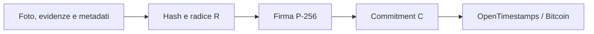

<!-- VINCOLO PER GLI AGENTI: Questo file contiene SOLO contenuti e indicazioni visive per le TRE slide della parte crypto, da coordinare con docs/pitch.md. Il parlato è esclusivamente in pitch.md: massimo 90 secondi TOTALI, comprese pause e cambi slide, non 90 secondi per slide. Obiettivo circa 70 secondi; non aggiungere slide o spiegazioni orali. Le formule sono supporto visivo facoltativo: NON devono essere pronunciate. Mantenere pochi elementi leggibili e distinguere funzionalità implementate, obiettivi e validazioni mancanti. I commenti sono istruzioni editoriali, non testo da proiettare. -->

# Una firma protegge i byte. L’origine richiede evidenze.

**FingerprinTO: tre evidenze distinguibili**

| Attestazione della cattura | Compatibilità PRNU | Integrità del file |
|---|---|---|
| Quando disponibile e verificata | Evidenza statistica del sensore | Hash e firma crittografica |

**Origine della cattura ≠ verità della scena.**

<!-- SLIDE 1 — Circa 20 secondi, primi due paragrafi di pitch.md. Visual: tre schede affiancate, non un badge universale di autenticità. Le evidenze possono coesistere: non suggerire che la verifica del produttore escluda il controllo PRNU. Il validatore reale del produttore manca ancora nel prototipo; il PRNU non è una garanzia crittografica di origine fisica. Non aggiungere formule o dettagli di calibrazione a questa slide. -->

---

# Una ricevuta verificabile

$$
C = D(\texttt{receipt}, R, \sigma)
\qquad
h_{\mathrm{OTS}} = \mathrm{SHA256}(C)
$$

**Ancoraggio temporale ≠ prova della scena o dell’istante di scatto.**

<!-- SLIDE 2 — Circa 25 secondi, terzo paragrafo di pitch.md. Il diagramma è un riassunto del flusso, non il grafo completo delle dipendenze: C lega sia R sia la firma. La firma usa la chiave dell'installazione protetta dal Keystore hardware; ciò non rende il Keystore una firma del sensore. D significa SHA256 di un array CBOR deterministico con separazione di dominio; OTS riceve i 32 byte grezzi di C e ne calcola l'hash. Formula facoltativa, piccola ma leggibile: NON leggerla. Per il dettaglio tecnico vedere crypto-flow.md e i relativi PNG, senza incollare sulla slide l'intero diagramma verticale. -->

---

# Verificabile anche domani

**Obiettivo proposto:** evidenze interoperabili e verificabilità nel tempo.

- Conservare certificati, manifest, policy e prove di stato.
- Rendere verificabili le evidenze anche oltre la disponibilità del vendor.

**Oggi:** nucleo crittografico offline implementato.

**Da completare:** integrazioni reali e calibrazione.

<!-- SLIDE 3 — Circa 25 secondi, ultimi due paragrafi di pitch.md. Presentare la conservazione della verificabilità storica come contributo proposto, non come archivio a lungo termine già implementato. Un certificato ancorato prova l'esistenza di quei byte, non che l'issuer fosse fidato o la chiave non compromessa. Le integrazioni mancanti comprendono validatore produttore e percorso Android; gli ultimi fix del modulo attendono test sul branch dedicato. Nessun claim di certificazione, sicurezza universale o verifica su sensori reali già conclusa. Chiudere entro circa 70 secondi complessivi; il tetto assoluto rimane 90. -->
